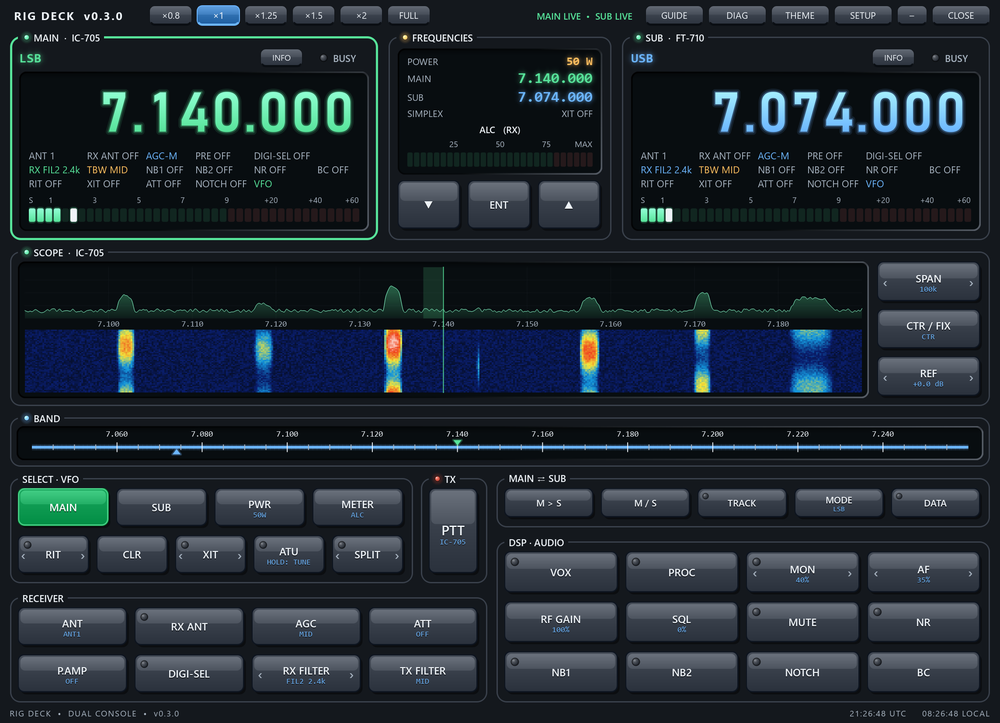

# Rig Deck

A free Windows dual-radio console for radio amateurs. **[Website and screenshots](https://lrizio.github.io/RigDeck/)** ·
**[Download for Windows](https://github.com/lrizio/RigDeck/releases/latest)** · [Disclaimer](DISCLAIMER.md) · MIT licence

A two-radio control console for Windows: one window, two radio panels
(MAIN on the left, SUB on the right), a shared band scale, and a button
deck that works whichever radio is selected. Set up for an **Icom IC-705**
(MAIN) and a **Yaesu FT-710** (SUB). Any other pair works through Hamlib.



## User guide

The **Rig Deck User Guide.pdf** is in the download zip (and opens from the GUIDE button). Regenerate it with `python build_user_guide.py`; the screenshots come from
`scripts/guide_screens.py`, rendered off-screen into `docs/guide/`.

## Running

* Download `RigDeck-0.3.0-windows.zip` from the [latest release](https://github.com/lrizio/RigDeck/releases/latest), unzip anywhere and run `Rig_Deck.exe` (not code-signed, so Windows SmartScreen may warn: *More info*, then *Run anyway*)
* From source: `python main.py` (needs `pip install -r requirements.txt`)
* `python main.py --demo` runs both sides simulated, with no radios needed

Settings live in `%APPDATA%\RigDeck\config.json` (the SETUP button edits them).

## Connections

| Type | Radios | Notes |
|---|---|---|
| Icom CI-V (direct) | IC-7300, IC-7300MK2, IC-7610, IC-7760, IC-7850/7851, IC-7800, IC-7700, IC-7600, IC-7410, IC-7200, IC-705, IC-7100, IC-7000, IC-9700, IC-9100, IC-905 | USB CI-V port ("IC-705 Serial Port A (CI-V)", here COM4). Leave the port blank and Rig Deck picks the COM port named after the radio. Each model's default CI-V address and baud are filled in (115200 for current radios, 19200 for older ones like the IC-7600/7410/7200/7100). DTR/RTS are held low so USB SEND/keying settings can never key the radio. |
| Yaesu CAT (direct) | FT-710, FTDX10, FTDX101D, FTDX101MP, FT-991A, FT-991, FT-891 (pick the model in Setup) | The **Enhanced** port of the CP2105 pair (FT-710 here: COM5, FT-991A: COM31), 38400 baud (FT-710 CAT-1 RATE / FT-991A menu 031 / the CAT RATE menu on the others). RTS is asserted (the FT-991A needs it). Older Yaesus (FT-450D, FT-950, FT-2000, FTDX1200/3000/5000) use a different filter-width scheme: run them through Hamlib. |
| Hamlib rigctld | anything Hamlib supports | Pick the model and port; Rig Deck starts its own hidden rigctld. Leave the port blank to join a rigctld that is already running (host:port). The button set is built from what Hamlib reports the radio can do. |
| Simulator | none | A pretend radio. |

Rig Deck checks GitHub once at start-up for a newer release (one small request; nothing is downloaded or
installed). Untick **Check GitHub for a newer Rig Deck** in SETUP to turn that off.

## Using the deck

* **MAIN / SUB** (or click a panel, or Tab) choose which radio the deck controls.
  Button labels follow that radio's own names (COMP vs PROC, ANF vs DNF, IPO vs P.AMP...).
  Buttons the radio doesn't have are greyed out.
* **Tuning:** mouse wheel over any digit of a frequency display tunes that digit.
  Double-click a display to type a frequency (`7.074`, `14074`, `14074000` all work).
  Click the band scale to jump there; wheel over it for 1 kHz steps.
* **Arrow buttons** (‹ RIT ›, ‹ XIT ›, ‹ SPLIT ›, ‹ RX FILTER ›, ‹ MON ›, ‹ AF ›):
  click the middle to toggle, click an arrow (or use the wheel) to adjust.
  RIT/XIT ±10 Hz, SPLIT moves the TX VFO ±1 kHz, RX FILTER steps the width.
* **PWR, RF GAIN, SQL, AF:** click to select, then use ▼ / ▲ in the centre
  (or the wheel on the button). ENT returns ▼/▲ to tuning (1 kHz);
  when already tuning, ENT opens frequency entry.
* **Right-click** a choice button (AGC, ATT, PRE AMP, ANT, TX FILTER) for a list.
  **Press and hold ATU** (or right-click it) to start a tune cycle (this transmits).
* **M > S** copies MAIN's frequency and mode to SUB. **M / S** swaps them.
  **TRACK** makes SUB follow MAIN's tuning. **MUTE** zeroes the selected radio's
  AF gain and restores it on the next press (and on exit).
* **SCOPE** (IC-705, IC-7610): the radio's own spectrum scope streamed over CI-V, as a trace over a
  waterfall. Click it to tune there, and wheel over it for 100 Hz steps. SPAN ‹ › (5 kHz-1 MHz), CTR/FIX,
  and REF ‹ › (-20 to +20 dB, or select it and use ▼/▲). The shaded area is your RX passband;
  a second line marks where the other radio is. The waterfall adds one 3-pixel row per sweep, keeps its
  history across odd sweeps, and stretches contrast from the noise floor so noise stays dark blue. The FT-710 has no scope over CAT, so it gets none.
  Rig Deck switches the radio's scope data output on while connected and back off on exit.
  If both radios on the deck have a scope (e.g. IC-705 + IC-7610), the panel shows the
  selected one and switches with MAIN / SUB. The IC-7610 panel shows its MAIN-receiver scope.
* **PTT** toggles transmit on the selected radio. Only one radio transmits at a time, and PTT
  is released automatically after the time-out set in SETUP (default 180 s).
* **METER** chooses the TX meter shown in the centre (PO / ALC / SWR / COMP).
* **×0.8 … ×2 / FULL** zoom the whole console (F11 = full screen). Drag the bottom-right corner grip to
  resize the window freely; the console rescales to fit and the size is remembered (a zoom button resets it). **THEME** cycles
  Shack (the HamProjects 3D look) / Flight Deck / Amber Night / Phosphor / Daylight. **DIAG** shows live CAT traffic.
  **GUIDE** opens this User Guide (a copy is built into the exe).

## Sharing a radio with JTDX, WSJT-X, loggers, ICOMNodeDisplay

Only one program can open a COM port. Rig Deck holds the radio's port and shares each
radio over rigctld's network protocol, so other programs connect to Rig Deck instead:

| In the other program | Setting |
|---|---|
| Rig | **Hamlib NET rigctl** |
| Network server | **127.0.0.1:4532** (MAIN) or **127.0.0.1:4533** (SUB) |
| PTT method | **CAT** |

Nothing to install (no virtual COM ports, no drivers), and the other program's settings
don't change when you swap radios in Rig Deck. Reads are answered from Rig Deck's own
state (no extra radio traffic); writes go through the same queue as the deck's buttons.
A remote PTT follows the deck's rules: only one radio transmits, and the PTT time-out applies.
The top bar shows `SHARED :4532(1) :4533` (connected programs in brackets), or `:4532 IN USE`
if another program already has the port.
Start order doesn't matter with ICOMNodeDisplay: started second, its launcher detects Rig Deck
and skips its own rigctld; started first, Rig Deck closes that rigctld (only a `rigctld.exe`
running on the COM port Rig Deck is waiting for, and only for a shared radio), takes the port,
and ICOMNodeDisplay carries on through Rig Deck. FreeDV works the same way as JTDX
(Tools → PTT Config → Hamlib, rig *Hamlib NET rigctl*, serial device `127.0.0.1:4532`).
Turn sharing off or change the ports in SETUP. Demo mode (`--demo`) never shares.
Tested with Hamlib 4.7.1's own client (`rigctl -m 2`, the code JTDX/WSJT-X use) and the
ICOMNodeDisplay bridge, against simulated radios; not yet with JTDX on a real radio.

## Status

* **FT-710:** every receive-side command was verified on the real radio (set,
  read back, restore). PTT (`TX1;`), tune (`AC003;`) and VOX have **not** been
  keyed during testing. Their formats come from the manual and Hamlib.
  The FT-710 does not report squelch status over CAT, so its BUSY light stays grey.
* **IC-705:** every receive-side control was verified on the real radio (set,
  read back, restore). PTT was not keyed. The IC-705 has no internal tuner, so ATU
  is greyed. P.AMP switches ATT off, and MN switches ANF off: that is the radio's own interlock.
  If the IC-705 stops answering while Windows still shows its COM port as OK, re-plug it
  into a different USB socket (seen 2026-09-27: a power cycle didn't help, a new port did).
* **IC-7610 / IC-7300 / IC-9700:** same CI-V driver, tested against the scripted fake
  (`tests/fake_icom.py` on a com0com pair) only.
* **The other Icom and Yaesu models** (added 2026-09-30) have **not** been on the bench.
  Their differences come from Hamlib's driver sources: CI-V address, attenuator and preamp
  steps, AGC codes, mode lists, DATA sub-command, and which commands exist (RIT/ΔTX via 0x21,
  other-VFO via 0x25, tuner) for Icom; radio ID, split command (ST vs FT), clarifier style
  (CF vs RT/XT+RU/RD), filter-width write format, meter tables and tuner-start code for Yaesu.
  Controls a model lacks are hidden. Only the IC-705 and IC-7610 have the scope switched on (the IC-7610 one is untested
  on the radio: 689 points, levels 0-200 per Hamlib), and only the
  IC-7610 has the ANT buttons. The FTDX101 is driven on MAIN only. The FT-891 has no CAT clarifier switch,
  so it has no RIT/XIT buttons. The per-model tables are unit-tested (`tests/test_protocols.py`).
* See [docs/protocol-notes.md](docs/protocol-notes.md) for the details and the
  two FT-710 quirks found on the bench.

## Development

```
python tests/test_protocols.py          # protocol unit tests
python tests/fake_icom.py COM20         # fake IC-7610 (point Rig Deck at COM19)
python scripts/make_icon.py             # regenerate icon.ico
python build_user_guide.py              # regenerate build/Rig Deck User Guide.pdf (before the exe: it's bundled)
python -m PyInstaller --noconfirm --onefile --windowed --name Rig_Deck --icon icon.ico --add-data "icon.ico;." --add-data "build/Rig Deck User Guide.pdf;." --distpath build --workpath %TEMP%\rigdeck_pyi --specpath %TEMP%\rigdeck_pyi main.py
```

The `--workpath`/`--specpath` keep PyInstaller's work files out of `build/`. When `--specpath`
is elsewhere, give `--icon` and `--add-data` absolute paths.

Code layout: `rigdeck/backends/` has one driver per protocol, all behind the same
`Backend` interface (a state snapshot plus `set()`/`action()`, with serial I/O on
the driver's own thread). `rigdeck/ui/` is the PySide6 console.
